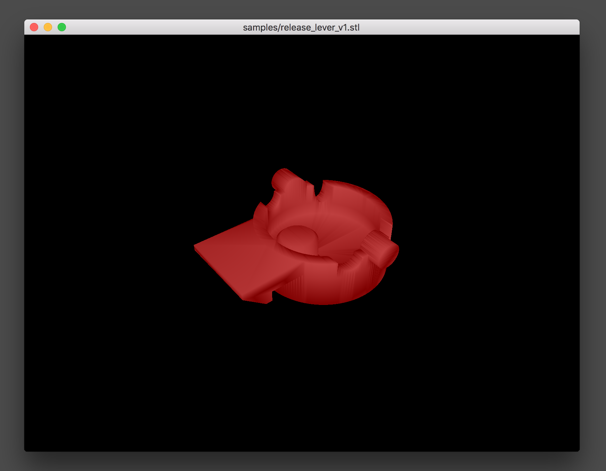

# Watch stl

Display an stl in a native window. Refresh whenever the file is modified.

## Installation

```
git clone https://github.com/bddap/watch-stl-rust.git
cd watch-stl-rust
cargo install --path .
```

You'll need the [rust compiler](https://www.rust-lang.org/en-US/install.html) for that last step.

## Use

```
watch-stl path/to/model.stl
```

Now you can use your mouse to rotate and zoom the model.



## License

Licensed under either of

 * Apache License, Version 2.0, ([LICENSE-APACHE](LICENSE-APACHE) or http://www.apache.org/licenses/LICENSE-2.0)
 * MIT license ([LICENSE-MIT](LICENSE-MIT) or http://opensource.org/licenses/MIT)

at your option.

### Contribution

Unless you explicitly state otherwise, any contribution intentionally submitted
for inclusion in the work by you, as defined in the Apache-2.0 license, shall be
dual licensed as above, without any additional terms or conditions.
